<style type="text/css">
/* Page layout */
body {
  max-width: 960px;
  margin: auto;
  padding: 20px 40px 60px 40px;
  line-height: 1.6;
  font-size: 14px;
}

/* Heading spacing */
h1 { margin-top: 60px; margin-bottom: 20px; }
h2 { margin-top: 50px; margin-bottom: 16px; border-bottom: 2px solid #ccc; padding-bottom: 8px;}
h3 { margin-top: 60px; margin-bottom: 12px; border-bottom: 1px solid #ddd; padding-bottom: 6px;}
h4 { margin-top: 24px; margin-bottom: 10px; }

/* Space around chunk output (plots, tables, printed objects) */
.r + .output,
.sourceCode + .output { margin-top: 12px; }

pre, .sourceCode {
  margin-top: 10px;
  margin-bottom: 10px;
}

/* Figures */
img, .plot {
  display: block;
  margin-top: 16px;
  margin-bottom: 24px;
}

/* Paged data frame tables */
.pagedtable-wrapper {
  margin-top: 16px;
  margin-bottom: 24px;
}

/* kable / standard HTML tables */
table {
  margin-top: 16px;
  margin-bottom: 24px;
  border-collapse: collapse;
  width: 100%;
}

th, td {
  padding: 8px 12px;
  border: 1px solid #ddd;
  text-align: left;
}

th { background-color: #f5f5f5; }
tr:nth-child(even) { background-color: #fafafa; }
</style>


## Figure 3

### (A) CD3

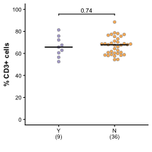

```
## # A tibble: 1 × 7
##   estimate statistic p.value conf.low conf.high method               alternative
##      <dbl>     <dbl>   <dbl>    <dbl>     <dbl> <chr>                <chr>      
## 1     -1.2       150    0.74     -7.8         6 Wilcoxon rank sum t… two.sided
```

### (B) CD8

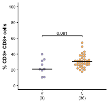

```
## # A tibble: 1 × 7
##   estimate statistic p.value conf.low conf.high method               alternative
##      <dbl>     <dbl>   <dbl>    <dbl>     <dbl> <chr>                <chr>      
## 1       -7       100   0.081      -14       0.7 Wilcoxon rank sum t… two.sided
```

### (C) CD4

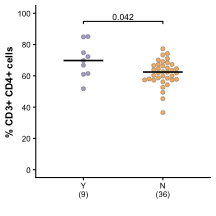

```
## # A tibble: 1 × 7
##   estimate statistic p.value conf.low conf.high method               alternative
##      <dbl>     <dbl>   <dbl>    <dbl>     <dbl> <chr>                <chr>      
## 1      7.5       230   0.042      0.5        16 Wilcoxon rank sum t… two.sided
```

### (D) CD4:CD8

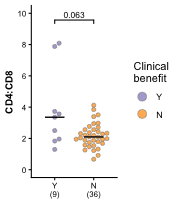

```
## # A tibble: 1 × 7
##   estimate statistic p.value conf.low conf.high method               alternative
##      <dbl>     <dbl>   <dbl>    <dbl>     <dbl> <chr>                <chr>      
## 1     0.99       230   0.063   -0.049         2 Wilcoxon rank sum t… two.sided
```

### (E) CD8 PD-1 by clinical benefit

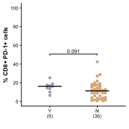

```
## # A tibble: 1 × 7
##   estimate statistic p.value conf.low conf.high method               alternative
##      <dbl>     <dbl>   <dbl>    <dbl>     <dbl> <chr>                <chr>      
## 1      4.7       220   0.091       -1       9.9 Wilcoxon rank sum t… two.sided
```

### (F) CD4 PD-1 by clinical benefit

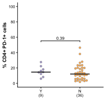

```
## # A tibble: 1 × 7
##   estimate statistic p.value conf.low conf.high method               alternative
##      <dbl>     <dbl>   <dbl>    <dbl>     <dbl> <chr>                <chr>      
## 1      2.4       190    0.39     -4.7       8.6 Wilcoxon rank sum t… two.sided
```

### (G) CD8 PD-1 by prior treatment

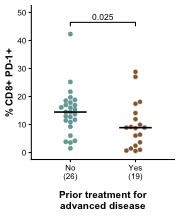

```
## # A tibble: 1 × 7
##   estimate statistic p.value conf.low conf.high method               alternative
##      <dbl>     <dbl>   <dbl>    <dbl>     <dbl> <chr>                <chr>      
## 1      5.3       340   0.025      0.7       9.8 Wilcoxon rank sum t… two.sided
```

### (G) CD4 PD-1 by prior treatment

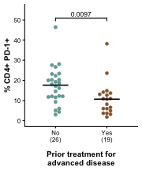

```
## # A tibble: 1 × 7
##   estimate statistic p.value conf.low conf.high method               alternative
##      <dbl>     <dbl>   <dbl>    <dbl>     <dbl> <chr>                <chr>      
## 1        7       360  0.0097      1.6        12 Wilcoxon rank sum t… two.sided
```

### Fig 3 layout

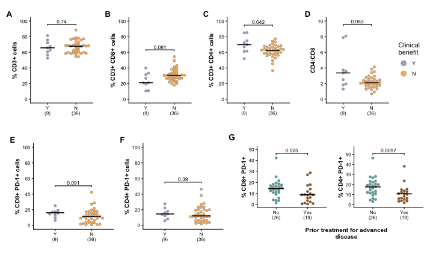

## Figure 4

### (A) CD8 PD-1 timecourse

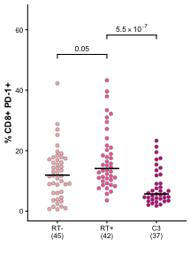

```
## # A tibble: 2 × 9
##   estimate statistic    p.value conf.low conf.high method alternative comparison
##      <dbl>     <dbl>      <dbl>    <dbl>     <dbl> <chr>  <chr>       <chr>     
## 1     -4         290 0.05           -7.7    -0.015 Wilco… two.sided   Baseline …
## 2      8.1       590 0.00000055      5.9    12     Wilco… two.sided   Cycle 1 v…
## # ℹ 1 more variable: p.value2 <chr>
```

### (B) CD4 PD-1 timecourse

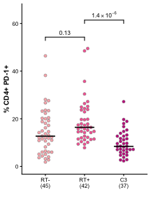

```
## # A tibble: 2 × 9
##   estimate statistic   p.value conf.low conf.high method  alternative comparison
##      <dbl>     <dbl>     <dbl>    <dbl>     <dbl> <chr>   <chr>       <chr>     
## 1     -2.6       330 0.13          -6.8         1 Wilcox… two.sided   Baseline …
## 2      7         580 0.0000014      5          10 Wilcox… two.sided   Cycle 1 v…
## # ℹ 1 more variable: p.value2 <chr>
```

### (C) Tpex

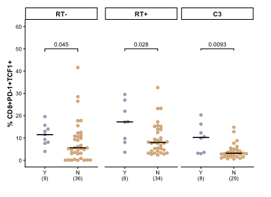

```
## # A tibble: 3 × 8
##   Timepoint estimate statistic p.value conf.low conf.high method     alternative
##   <fct>        <dbl>     <dbl>   <dbl>    <dbl>     <dbl> <chr>      <chr>      
## 1 Baseline       4.7       230  0.045      0.2          9 Wilcoxon … two.sided  
## 2 Cycle 1        7.4       200  0.028      0.42        14 Wilcoxon … two.sided  
## 3 Cycle 3        6.6       190  0.0093     0.84        10 Wilcoxon … two.sided
```

### (D) CD8 EOMES

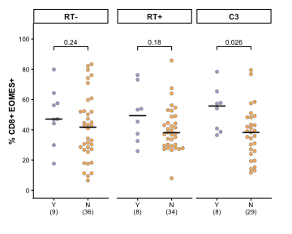

```
## # A tibble: 3 × 8
##   Timepoint estimate statistic p.value conf.low conf.high method     alternative
##   <fct>        <dbl>     <dbl>   <dbl>    <dbl>     <dbl> <chr>      <chr>      
## 1 Baseline      11         200   0.24      -6.6        26 Wilcoxon … two.sided  
## 2 Cycle 1        8.8       180   0.18      -3.7        24 Wilcoxon … two.sided  
## 3 Cycle 3       17         180   0.026      2.1        29 Wilcoxon … two.sided
```

### (E) CD4 EOMES

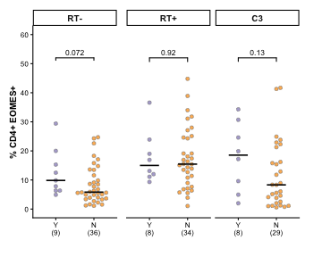

```
## # A tibble: 3 × 8
##   Timepoint estimate statistic p.value conf.low conf.high method     alternative
##   <fct>        <dbl>     <dbl>   <dbl>    <dbl>     <dbl> <chr>      <chr>      
## 1 Baseline      3.6        230   0.072    -0.65       8.5 Wilcoxon … two.sided  
## 2 Cycle 1       0.48       140   0.92     -6.3        7.5 Wilcoxon … two.sided  
## 3 Cycle 3       7.4        160   0.13     -2.6       17   Wilcoxon … two.sided
```

### Fig 4 layout

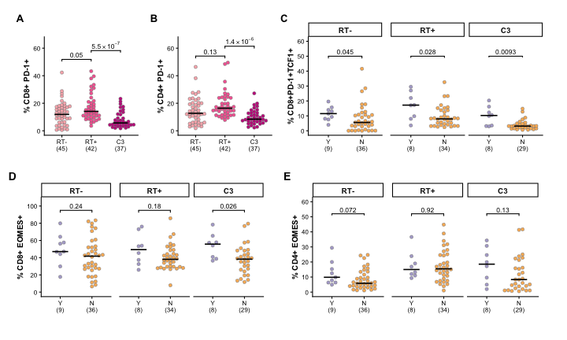

## Figire S4 (By Treatment Arm)

### (A) CD3

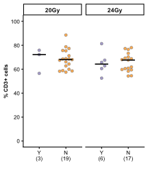

### (B) CD8

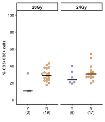

### (C) CD4

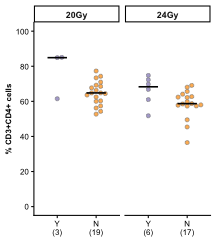

### (D) CD4:CD8

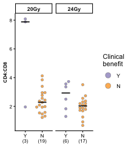

### (E) CD8 PD-1 by clinical benefit

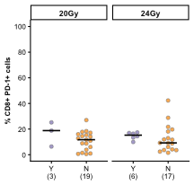

### (F) CD4 PD-1 by clinical benefit

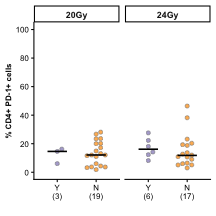

### (G) CD8 PD-1 by prior treatment

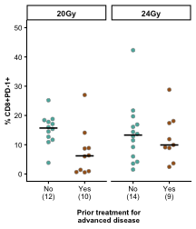

### (G) CD4 PD-1 by prior treatment

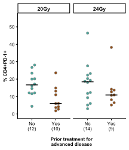

### Fig S4 layout

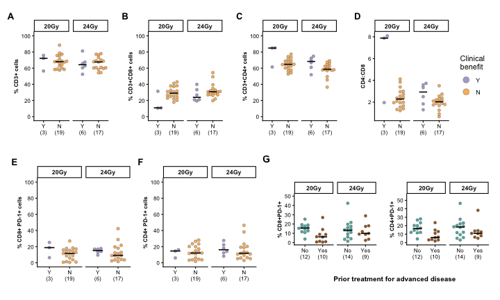

## Figure S5 (By Treatment Arm)

### (A) CD8 PD-1 timecourse by treatment

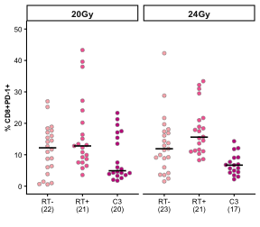

### (B) CD4 PD-1 timecourse by treatment

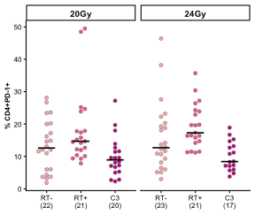

### (C) Tpex by treatment

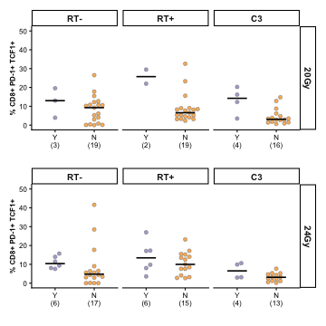

### (D) CD8 EOMES by treatment

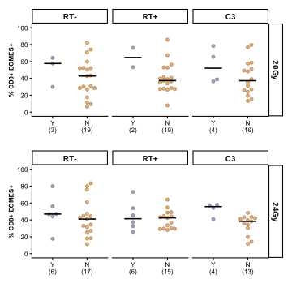

### (E) CD4 EOMES by treatment

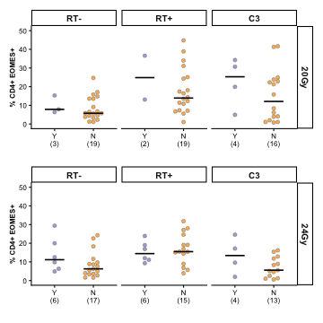

### Fig S5 layout

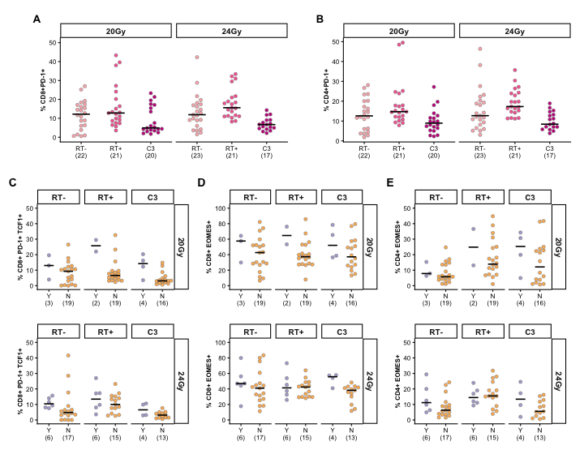

## Tumour TILs and clinical benefit analysis


```
## ROC TILs for Clinical Benefit AUC
```

```
## [1] 0.6194853
```

```
## 95% CI: 0.3051-0.9339 (DeLong)
```

```
## 
## Call:
## glm(formula = CBFLR ~ TILs_1, family = binomial)
## 
## Coefficients:
##             Estimate Std. Error z value Pr(>|z|)    
## (Intercept)  -2.4779     0.6590  -3.760  0.00017 ***
## TILs_1        0.5426     0.2354   2.306  0.02114 *  
## ---
## Signif. codes:  0 '***' 0.001 '**' 0.01 '*' 0.05 '.' 0.1 ' ' 1
## 
## (Dispersion parameter for binomial family taken to be 1)
## 
##     Null deviance: 40.901  on 41  degrees of freedom
## Residual deviance: 34.314  on 40  degrees of freedom
## AIC: 38.314
## 
## Number of Fisher Scoring iterations: 4
```

```
##                     OR      2.5 %    97.5 %
## (Intercept) 0.08392316 0.01860646 0.2632268
## TILs_1      1.72050562 1.13190907 2.9329315
```

<br>
<br>
<br>

## Session info

``` r
sessionInfo()
## R version 4.3.3 (2024-02-29)
## Platform: aarch64-apple-darwin20 (64-bit)
## Running under: macOS 15.8.1
## 
## Matrix products: default
## BLAS:   /Library/Frameworks/R.framework/Versions/4.3-arm64/Resources/lib/libRblas.0.dylib 
## LAPACK: /Library/Frameworks/R.framework/Versions/4.3-arm64/Resources/lib/libRlapack.dylib;  LAPACK version 3.11.0
## 
## locale:
## [1] C/C.UTF-8/C/C/C/C
## 
## time zone: America/New_York
## tzcode source: internal
## 
## attached base packages:
## [1] stats     graphics  grDevices utils     datasets  methods   base     
## 
## other attached packages:
##  [1] pROC_1.18.5     ROCR_1.0-11     patchwork_1.3.2 knitr_1.51     
##  [5] readxl_1.4.5    stringr_1.6.0   ggplot2_4.0.2   magrittr_2.0.5 
##  [9] tidyr_1.3.2     dplyr_1.2.1    
## 
## loaded via a namespace (and not attached):
##  [1] gtable_0.3.6         ggsignif_0.6.4       compiler_4.3.3      
##  [4] tidyselect_1.2.1     Rcpp_1.1.0           scales_1.4.0        
##  [7] ggdist_3.3.3         R6_2.6.1             plyr_1.8.9          
## [10] labeling_0.4.3       generics_0.1.4       distributional_0.5.0
## [13] MASS_7.3-60.0.1      backports_1.5.0      tibble_3.3.1        
## [16] pillar_1.11.1        RColorBrewer_1.1-3   rlang_1.2.0         
## [19] utf8_1.2.6           broom_1.0.8          stringi_1.8.7       
## [22] xfun_0.57            quadprog_1.5-8       S7_0.2.1            
## [25] otel_0.2.0           cli_3.6.5            withr_3.0.2         
## [28] grid_4.3.3           cowplot_1.2.0        lifecycle_1.0.5     
## [31] vctrs_0.7.2          evaluate_1.0.5       glue_1.8.0          
## [34] farver_2.1.2         cellranger_1.1.0     purrr_1.2.2         
## [37] tools_4.3.3          pkgconfig_2.0.3
```

